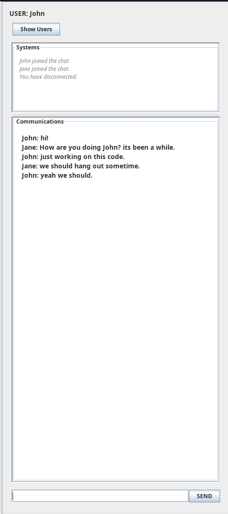
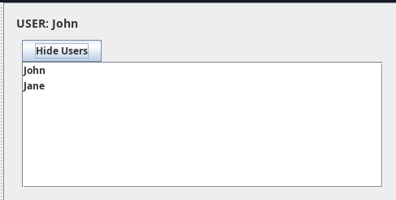
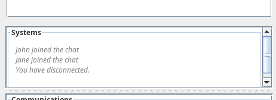
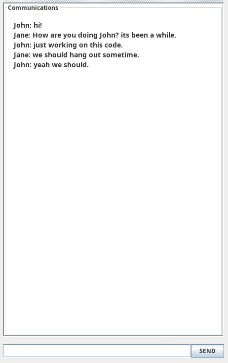

### **TableTopSync User Manual**

**Ramiyan Gangatharan (100835223)**  
Faculty of Science, University of Ontario Institute of Technology  
CSCI 2020U: Software Systems Development  
Dr. Mariana Shimabukuro  

**April 2026**

## **Overview**

The **Chat Module** enables real-time communication between users within the TableTopSync application.  
It allows users to exchange text messages while also displaying system-level events such as users joining or leaving the session.

 

---

## **Interface Breakdown**

The graphical user interface is divided into four main sections:

---

### **1. User Label**
Displays the currently logged-in user  
*(e.g., `USER: generic_username`)*, clearly indicating who is interacting with the system.

---

### **2. User Toggle Button**
Allows users to show or hide the **Active Users Panel**, which displays:
- A live count of connected users  
- A list of usernames currently in the session  

 

---

### **3. System Messages Panel**
Displays server-side activity, including:
- User join/leave events  
- Server status updates  
- Error messages  

 

---

### **4. Communications Panel**
The primary chat interface where users can send and receive messages in real time.  
Messages are displayed in chronological order using a consistent format.

 

---